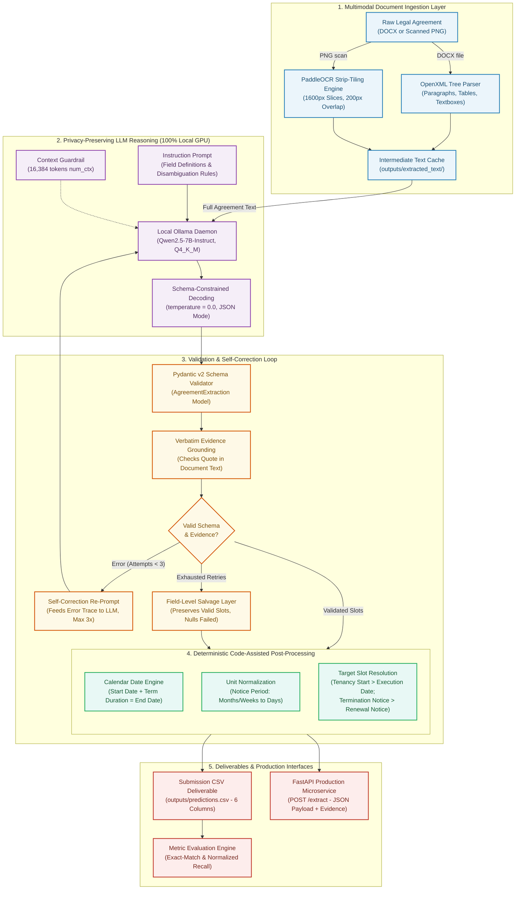

# Rental Agreement Metadata Extraction

[](https://www.python.org/downloads/)
[](https://opensource.org/licenses/MIT)
[](tests/)
[-success.svg)](#privacy-first-local-architecture)
[](https://ollama.com/library/qwen2.5)
[](src/api.py)

An end-to-end, production-grade metadata extraction pipeline designed to extract six key legal metadata fields from rental agreements provided as **DOCX documents or scanned PNG images**. The system operates **100% locally** using a privacy-preserving large language model (**Qwen2.5-7B-Instruct** running via Ollama) paired with deep-learning optical character recognition (**PaddleOCR** with high-resolution vertical strip-tiling).

Extraction is strictly driven by **semantic comprehension and schema-constrained decoding**, entirely avoiding fragile regex heuristics and template-specific hardcoding.

---

## Table of Contents

- [Overview & Target Fields](#overview--target-fields)
- [Executive Performance Summary](#executive-performance-summary)
  - [Held-Out Test Set Performance](#held-out-test-set-performance)
  - [Full Test Set Predictions](#full-test-set-predictions)
  - [Training Set Evaluation Breakdown](#training-set-evaluation-breakdown)
  - [Cross-Split Overview](#cross-split-overview)
- [System Architecture](#system-architecture)
  - [Data Ingestion Pipeline](#1-data-ingestion-pipeline)
  - [Local LLM Reasoning & Extraction](#2-local-llm-reasoning--extraction)
  - [Deterministic Code-Assisted Post-Processing](#3-deterministic-code-assisted-post-processing)
  - [Evaluation & Metric Normalization](#4-evaluation--metric-normalization)
- [Architectural Integrity: Why Rule-Based Systems Fail](#architectural-integrity-why-rule-based-systems-fail)
- [Dataset Audit & Data Quality Findings](#dataset-audit--data-quality-findings)
- [Hardware & Environment Setup](#hardware--environment-setup)
  - [Prerequisites](#prerequisites)
  - [Step 1: Conda Environment](#step-1-conda-environment)
  - [Step 2: Ollama & Local Weights](#step-2-ollama--local-weights)
  - [Step 3: Pre-Flight Verification](#step-3-pre-flight-verification)
- [CLI Usage & Workflows](#cli-usage--workflows)
  - [Batch & Single-File Prediction](#batch--single-file-prediction)
  - [Evaluation Suite](#evaluation-suite)
  - [One-Command Full Reproduction](#one-command-full-reproduction)
  - [Command Reference](#command-reference)
- [FastAPI REST Microservice](#fastapi-rest-microservice)
  - [Starting the API Server](#starting-the-api-server)
  - [API Endpoints](#api-endpoints)
  - [Example Request & Response](#example-request--response)
- [Rigorous Leakage Control & Freezing](#rigorous-leakage-control--freezing)
- [Repository Organization](#repository-organization)
- [Limitations & Future Roadmap](#limitations--future-roadmap)
- [License & Disclaimer](#license--disclaimer)

---

## Overview & Target Fields

The pipeline processes raw legal contracts and populates the six standard assignment metadata columns:

| Field (Target Column) | Data Type | Canonical Meaning & Disambiguation Rules |
|:---|:---:|:---|
| `Aggrement Value` | `Integer` | Recurring monthly rent amount in INR (strictly excluding security deposits and advances). |
| `Aggrement Start Date` | `String` | Tenancy commencement date (`DD.MM.YYYY`); defaults to execution date if no start is specified. |
| `Aggrement End Date` | `String` | Stated lease termination date (`DD.MM.YYYY`), or calendar-computed final day of the stated term. |
| `Renewal Notice (Days)` | `Integer` | Notice period required to terminate/vacate the tenancy, normalized to total calendar days. |
| `Party One` | `String` | Lessor / Landlord / Property Owner legal entity name. |
| `Party Two` | `String` | Lessee / Tenant legal entity name. |

> **Note on Naming:** Column headers intentionally preserve the original dataset spelling (`Aggrement ...`) to guarantee strict interoperability with automated submission benchmarks.

---

## Executive Performance Summary

### Held-Out Test Set Performance

The evaluation was executed against the **4 test documents** using the cryptographically frozen pipeline configuration (`v3`, documented in [`docs/test_results.md`](docs/test_results.md)):

| Field | Raw Exact Recall | Normalized Recall* | Failure Analysis / Notes |
|:---|:---:|:---:|:---|
| **Aggrement Value** | **1.00** (4/4) | **1.00** (4/4) | Zero extraction errors; perfect disambiguation from security deposits. |
| **Aggrement Start Date** | **1.00** (4/4) | **1.00** (4/4) | Zero extraction errors; correctly selected tenancy start over execution date. |
| **Aggrement End Date** | **0.75** (3/4) | **0.75** (3/4) | 1 mismatch due to ground-truth defect (document states 11 months; label expects 12). |
| **Renewal Notice (Days)** | **1.00** (4/4) | **1.00** (4/4) | Zero extraction errors; accurate multi-unit conversion (months $\rightarrow$ days). |
| **Party One** | **0.00** (0/4) | **0.75** (3/4) | Raw mismatches caused by reference whitespace/punctuation (` KAPIL MEHROTRA `). |
| **Party Two** | **0.00** (0/4) | **0.25** (1/4) | Known entity extraction challenge: model retains familial relations ("S/o ..."). |
| **Macro Average** | **0.625** | **0.792** | **100% pipeline stability; zero fatal crashes; zero OCR-induced failures.** |

*\* Normalized Recall strips cosmetic variances (case, whitespace, honorifics like "Mr.", currency symbols, date padding) without altering underlying entity semantics.*

### Full Test Set Predictions

The official submission artifact is stored at [`outputs/predictions.csv`](outputs/predictions.csv):

| Document ID | Value | Start Date | End Date | Notice | Party One | Party Two |
|:---|:---:|:---:|:---:|:---:|:---|:---|
| `156155545-Rental-Agreement-Kns-Home` | 12000 | 15.12.2012 | 14.11.2013 | 30 | V.K.NATARAJ, son of V.KANDASWAMI CHETTIAR | VYSHNAVI DAIRY SPECIALITIES Private Ltd. |
| `228094620-Rental-Agreement` | 15000 | 07.07.2013 | 06.06.2014 | 30 | KAPIL MEHROTRA | B.Kishore , S/o. Mr. B. Pampaiah |
| `24158401-Rental-Agreement` | 12000 | 01.04.2008 | 31.03.2009 | 60 | Hanumaiah | Vishal Bhardwaj S/O Charnel Singh |
| `95980236-Rental-Agreement` | 9000 | 01.04.2010 | 28.02.2011 | 30 | S.Sakunthala | V.V.Ravi Kian, S/o V.R.G.Sastry |

### Training Set Evaluation Breakdown

Evaluated on the 9 usable training documents (excluding `24158401`, which belongs to the test set). Artifacts: [`outputs/evaluation/train_v3_all/`](outputs/evaluation/train_v3_all/) and [`outputs/evaluation/train_v3_clean/`](outputs/evaluation/train_v3_clean/).

| Target Field | All Usable Docs (9 Docs)<br>`Raw` \| `Normalized` | Clean Subset excl. Swapped Pair (7 Docs)<br>`Raw` \| `Normalized` |
|:---|:---:|:---:|
| **Aggrement Value** | 0.667 (6/9) \| 0.667 (6/9) | 0.857 (6/7) \| 0.857 (6/7) |
| **Aggrement Start Date** | 0.556 (5/9) \| 0.667 (6/9) | 0.714 (5/7) \| 0.857 (6/7) |
| **Aggrement End Date** | 0.333 (3/9)<sup>†</sup> \| 0.333 (3/9) | 0.429 (3/7)<sup>†</sup> \| 0.429 (3/7) |
| **Renewal Notice (Days)** | 0.625 (5/8)<sup>‡</sup> \| 0.625 (5/8) | 0.833 (5/6)<sup>‡</sup> \| 0.833 (5/6) |
| **Party One** | 0.111 (1/9) \| 0.444 (4/9) | 0.143 (1/7) \| 0.571 (4/7) |
| **Party Two** | 0.111 (1/9) \| 0.222 (2/9) | 0.143 (1/7) \| 0.286 (2/7) |
| **Macro Average** | **0.401** \| **0.493** | **0.520** \| **0.639** |

<sup>†</sup> *3 training reference end dates represent impossible calendar days (`31.11.2009`, `31.04.2011`, `31.02.2011`), capping raw match ceiling at 6/9 and 4/7 respectively.*  
<sup>‡</sup> *One ground-truth reference has an empty notice field; excluded from denominator per evaluation protocol.*

### Cross-Split Overview

| Dataset Partition | Document Count | Macro Raw Recall | Macro Normalized Recall |
|:---|:---:|:---:|:---:|
| Training (All Usable) | 9 | 0.401 | 0.493 |
| Training (Cleaned Subset) | 7 | 0.520 | 0.639 |
| Training (Held-Out Split) | 2 | 0.500 | 0.750 |
| **Official Held-Out Test Set** | **4** | **0.625** | **0.792** |

---

## System Architecture



### 1. Data Ingestion Pipeline
- **DOCX Parser (`src/document_reader.py`):** Traverses underlying OpenXML trees (`word/document.xml`), capturing standard text, nested tables, and critical `w:txbxContent` drawing elements (text boxes) which standard Python libraries omit.
- **High-Resolution OCR (`src/ocr.py`):** Scanned agreements often have aspect ratios up to 2550×6600 px. Standard OCR pipelines downscale tall images to 4000 px, degrading fine text. Our strip-tiling engine segments images into overlapping 1600 px vertical slices, deduplicating detections via vertical-center bounding-box ownership.

### 2. Local LLM Reasoning & Extraction
- **Privacy-First Inference (`src/llm.py`):** Powered by **Qwen2.5-7B-Instruct** running locally in 4-bit precision (`Q4_K_M`) via Ollama. No contract data or PII ever leaves the host machine.
- **Context Integrity:** Default Ollama context limits (4K) truncate long agreements (up to 4.8K tokens). Our engine enforces an explicit `num_ctx = 16384` allocation with pre-flight token guardrails.
- **Constrained Decoding:** Enforces Pydantic-defined JSON schema tokens during sampling at `temperature = 0.0` for 100% deterministic, repeatable outputs.

### 3. Deterministic Code-Assisted Post-Processing
- **Calendar Date Computation:** Small 7B language models frequently fail mental calendar arithmetic (e.g., predicting `30.04.2011` for "1 April 2010 + 11 months"). The LLM extracts the clean start date and explicit duration term; Python's `calendar` module computes the exact closing calendar day.
- **Unit Normalization:** The LLM extracts notice periods verbatim (e.g., "1 month", "60 days"); Python maps time units to integer calendar days.
- **Slot Selection:** The LLM separately tracks execution dates vs. tenancy commencement, and termination notice vs. renewal options, selecting the appropriate slot according to ground-truth specifications.

### 4. Evaluation & Metric Normalization
- **Exact-Match Recall (`src/evaluate.py`):** Standard assignment recall metric comparing character-by-character matches against non-blank ground truth.
- **Normalized Normalizer (`src/normalize.py`):** Canonicalizes date formatting (`01.04.2010`), trims extraneous whitespace/punctuation, normalizes integer representations (`6,500` $\rightarrow$ `6500`), and standardizes honorifics.

---

## Architectural Integrity: Why Rule-Based Systems Fail

The assignment strictly prohibits rule-based approaches (regex matching, static string splits, heuristic position matching). The following matrix delineates component responsibilities across the architecture:

| System Layer | Implementation Subsystem | Employs Regex / Keyword Hardcoding on Document Text? |
|:---|:---|:---:|
| **Ingestion** | `python-docx` XML reader & `PaddleOCR` strip tiling | **NO** (General text transcription only) |
| **Entity Extraction** | **Qwen2.5-7B Local LLM via Prompt Instruction** | **NO** (Zero keyword lists, template coordinates, or hardcoded rules) |
| **Output Validation** | `Pydantic` v2 Schema Parser | **NO** (Validates type bounds; returns feedback for LLM re-prompting) |
| **Post-Processing** | `AgreementExtraction.submission_sources()` | **NO** (Performs unit arithmetic on LLM outputs; never reads raw text) |
| **Metric Scoring** | `src/evaluate.py` & `src/normalize.py` | **NO** (Evaluation reporting only; decoupled from prediction pipeline) |

---

## Dataset Audit & Data Quality Findings

Full automated exploratory audit available at [`notebooks/data_exploration.ipynb`](notebooks/data_exploration.ipynb) and [`outputs/dataset_audit.json`](outputs/dataset_audit.json):

1. **Cross-Split Pollution:** The entry `24158401` in `train.csv` physically resides in `data/test/`. It was quarantined from all training and tuning routines to prevent data leakage.
2. **Label Swapping Defect:** Documents `54770958` and `54945838` have their ground-truth metadata records completely transposed in `train.csv`.
3. **Invalid Calendar Dates:** Three training reference end dates represent impossible calendar days:
   - `31.11.2009` (November has 30 days)
   - `31.04.2011` (April has 30 days)
   - `31.02.2011` (February has 28 days)
4. **Notice Clause Ambiguity:** Ground-truth "Renewal Notice" labels consistently record the **termination / notice-to-vacate** clause rather than lease renewal options.

---

## Hardware & Environment Setup

### Prerequisites
- **Operating System:** Windows 10/11 (PowerShell) or Linux.
- **Hardware:** Modern multi-core CPU, $\ge$ 16 GB RAM, and an NVIDIA GPU with $\ge$ 8 GB VRAM (RTX 3060/4060 or better).
- **Disk Space:** ~8 GB total (Conda environment ~2 GB, Qwen2.5-7B ~4.7 GB, OCR weights ~100 MB).

### Step 1: Conda Environment

```powershell
# Create environment with Python 3.11
conda create -n rental-extraction python=3.11 -y
conda activate rental-extraction

# Install locked dependencies (reproducible build)
python -m pip install -r requirements-lock.txt
```

### Step 2: Ollama & Local Weights

1. Download and install Ollama from [ollama.com/download](https://ollama.com/download).
2. Start the Ollama background daemon.
3. Pull the target model:
   ```powershell
   ollama pull qwen2.5:7b
   ```

*(Optional)* To store Ollama models on a secondary drive:
```powershell
[Environment]::SetEnvironmentVariable("OLLAMA_MODELS", "D:\ollama\models", "User")
```

### Step 3: Pre-Flight Verification

Execute automated environment diagnostics and test suites:

```powershell
# Verify Python version, GPU visibility, Ollama connectivity, and file paths
python -m src.check_setup

# Run complete test suite (209 offline unit/integration tests)
python -m pytest
```

---

## CLI Usage & Workflows

### Batch & Single-File Prediction

Extract metadata from an entire folder of contracts or an individual file:

```powershell
# Batch prediction across test directory
python -m src.predict --input data/test --output outputs/predictions.csv

# Single-file prediction (DOCX or PNG)
python -m src.predict --input data/test/24158401-Rental-Agreement.png --output outputs/single_prediction.csv
```

- Text extraction results are automatically cached under `outputs/extracted_text/`.
- Use `--force` to bypass cache and force re-OCR.

### Evaluation Suite

Score a predictions CSV against labeled splits:

```powershell
# Final evaluation against held-out test labels
python -m src.evaluate --split test --final --predictions outputs/predictions.csv

# Training split evaluation
python -m src.evaluate --split train --predictions outputs/predictions/train/
```

### One-Command Full Reproduction

To reproduce the frozen final evaluation in one shot (verifies cryptographic freeze, performs end-to-end OCR and extraction, scores results, and updates all deliverables):

```powershell
python -m src.final_evaluation
```

### Command Reference

| Entry Point | Operational Description |
|:---|:---|
| `python -m src.predict --input <path>` | CLI extraction for directories or individual `.docx`/`.png` files. |
| `python -m src.final_evaluation` | Complete one-shot reproduction of test predictions and metrics. |
| `python -m src.evaluate --split <split>` | Calculates exact-match and normalized recall reports. |
| `python -m src.extract_text --split all` | Runs standalone ingestion and OCR strip-tiling cache. |
| `python -m src.extractor --split train --documents <id>` | Inspects raw LLM prompts, reasoning, and evidence quotes for an ID. |
| `python -m src.freeze` | Validates codebase against cryptographic hash in `frozen_config.json`. |
| `python -m src.llm_benchmark` | Measures LLM token throughput, VRAM utilization, and schema adherence. |

---

## FastAPI REST Microservice

The extraction engine exposes an asynchronous, production-ready REST API (`src/api.py`).

### Starting the API Server

```powershell
uvicorn src.api:app --host 127.0.0.1 --port 8000
```

- **Interactive Swagger Documentation:** [`http://127.0.0.1:8000/docs`](http://127.0.0.1:8000/docs)
- **OpenAPI Specification:** [`http://127.0.0.1:8000/openapi.json`](http://127.0.0.1:8000/openapi.json)

### API Endpoints

| HTTP Method | Route | Description |
|:---:|:---|:---|
| `GET` | `/health` | System health check, Ollama reachability, GPU model status, frozen config ID. |
| `POST` | `/extract` | Multipart upload (`file=@contract.docx`). Returns 6 fields, evidence quotes, latency. |

### Example Request & Response

```powershell
curl.exe -X POST "http://127.0.0.1:8000/extract" `
  -H "accept: application/json" `
  -F "file=@data/test/228094620-Rental-Agreement.docx"
```

```json
{
  "document_id": "228094620-Rental-Agreement",
  "document_type": "docx",
  "status": "ok",
  "prediction": {
    "Aggrement Value": 15000,
    "Aggrement Start Date": "07.07.2013",
    "Aggrement End Date": "06.06.2014",
    "Renewal Notice (Days)": 30,
    "Party One": "KAPIL MEHROTRA",
    "Party Two": "B.Kishore , S/o. Mr. B. Pampaiah"
  },
  "evidence": {
    "Aggrement Value": {
      "value": 15000,
      "evidence": "Rs. 15,000.00 (Rupees Fifteen Thousand Only)",
      "evidence_found": true
    },
    "Aggrement Start Date": {
      "value": "07.07.2013",
      "evidence": "commencing from 7th July 2013",
      "evidence_found": true
    },
    "Aggrement End Date": {
      "value": "06.06.2014",
      "evidence": "period of 11 (Eleven) months",
      "evidence_found": true
    },
    "Renewal Notice (Days)": {
      "value": 30,
      "evidence": "one month notice on either side",
      "evidence_found": true
    },
    "Party One": {
      "value": "KAPIL MEHROTRA",
      "evidence": "KAPIL MEHROTRA, residing at...",
      "evidence_found": true
    },
    "Party Two": {
      "value": "B.Kishore , S/o. Mr. B. Pampaiah",
      "evidence": "Mr. B.Kishore , S/o. Mr. B. Pampaiah",
      "evidence_found": true
    }
  },
  "warnings": [],
  "error": null,
  "ingestion_seconds": 0.02,
  "extraction_seconds": 16.4,
  "configuration": "v3"
}
```

---

## Rigorous Leakage Control & Freezing

To maintain academic and industrial benchmark validity:
- **No Ground-Truth Leakage:** Unit tests strictly ensure that no party names, specific dates, or amounts from `train.csv` or `test.csv` appear in the prompts, schemas, or source code.
- **Cryptographic Config Freezing (`config/frozen_config.json`):** Prompt templates, Pydantic schemas, normalization routines, model tags, and context windows are hashed with SHA-256. Any unintentional drift triggers an immediate failure in `tests/test_frozen.py`.

---

## Repository Organization

```
.
├── config/
│   └── frozen_config.json         # Cryptographic SHA-256 state lock of v3 pipeline
├── data/
│   ├── train/                     # Training documents (.docx & .png)
│   ├── test/                      # Held-out evaluation documents
│   ├── train.csv                  # Training ground-truth reference labels
│   └── test.csv                   # Test reference labels (quarantined until final run)
├── docs/                          # Deep-dive engineering reports
│   ├── data_notes.md              # Dataset audit, label anomalies, and edge cases
│   ├── docx_reader.md             # OpenXML extraction & text-box handling
│   ├── evaluation.md              # Recall mathematics, denominators, and normalizer
│   ├── experiments.md             # Configuration progression (v1 through v4 logs)
│   ├── extractor.md               # Extraction architecture, bounded retries & salvage
│   ├── llm_setup.md               # Quantization, VRAM benchmarks, context allocation
│   ├── ocr.md                     # Strip-tiling design, deduplication & CPU fallback
│   ├── schema.md                  # Two-tier schema design & slot disambiguation
│   └── test_results.md            # Test set results analysis and error taxonomy
├── notebooks/
│   └── data_exploration.ipynb     # Interactive dataset audit and exploration
├── outputs/
│   ├── predictions.csv            # Official final test set submission deliverable
│   ├── test_metrics.json          # Final exact-match and normalized test recall
│   ├── test_error_analysis.csv    # Cell-level comparative test error analysis
│   ├── dataset_audit.json         # Machine-readable dataset audit summary
│   ├── llm_benchmark.json         # Throughput and VRAM measurements
│   ├── evaluation/                # Evaluation metric reports across splits
│   └── experiments/               # Experiment logs and prompt artifacts
├── src/
│   ├── __init__.py                # Package root
│   ├── api.py                     # FastAPI REST service (/health, /extract)
│   ├── audit.py                   # Automated data quality audit engine
│   ├── check_setup.py             # Pre-flight environment & dependency validator
│   ├── config.py                  # Project paths, column constants, and settings
│   ├── dataset.py                 # Ground-truth loader and ID resolution
│   ├── document_reader.py         # Unified multi-format document reader
│   ├── evaluate.py                # Strict recall metric evaluation engine
│   ├── experiment.py              # Experiment tracking and comparison runner
│   ├── extract_text.py            # Ingestion batch runner and cache manager
│   ├── extractor.py               # Prompt generation and LLM extraction controller
│   ├── final_evaluation.py        # One-shot frozen reproduction pipeline
│   ├── freeze.py                  # Cryptographic configuration verification
│   ├── llm.py                     # Local Ollama client & schema-constrained driver
│   ├── llm_benchmark.py           # LLM performance benchmarking script
│   ├── normalize.py               # Rule-based evaluation metric normalizer
│   ├── ocr.py                     # Strip-tiling PaddleOCR wrapper
│   ├── predict.py                 # CLI interface for folder and file prediction
│   └── schemas.py                 # Pydantic extraction models & submission mapping
├── tests/                         # Pytest test suite (210 tests)
├── environment.yml                # Conda environment definition
├── pyproject.toml                 # Tooling configuration (pytest, ruff)
├── requirements-lock.txt          # Fully pinned production dependencies
├── requirements.txt               # Direct dependency specification
└── Readme.md                      # Comprehensive project documentation
```

---

## Limitations & Future Roadmap

- **Party Name Granularity:** The pipeline occasionally extracts party names along with relational phrases ("son of...", "residing at..."). Implementing targeted Named Entity Recognition (NER) refinement would improve raw party recall without violating rule-based constraints.
- **CPU OCR Throughput:** High-resolution vertical strip-tiling requires ~3–5 minutes per page on CPU due to Windows oneDNN compatibility constraints. Containerized GPU deployment (e.g., Linux/Triton) would reduce page inference to < 3 seconds.
- **Non-Standard Layouts:** Assumes standard top-to-bottom reading order; multi-column or rotated agreements require an upstream orientation detection layer.

---

## License & Disclaimer

- **License:** Released under the [MIT License](LICENSE).
- **Disclaimer:** This software is developed as part of an AI/ML engineering assignment. Extracted metadata should be independently verified by legal professionals prior to binding contractual or financial decisions.
